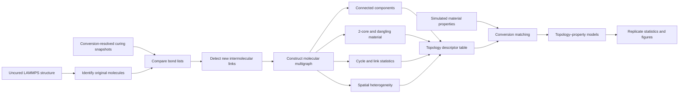

# Topology-Property-Pipeline

# Polymer Network Topology–Property Analysis

This repository presents a computational workflow for following the formation of a thermoset network during molecular-dynamics curing simulations. The analysis converts reaction-resolved LAMMPS structures into molecular graphs, measures how connectivity develops with conversion, and relates the resulting network descriptors to simulated thermophysical properties.

The complete implementation is maintained privately. This public repository documents the scientific methodology, representative results, and interpretation framework.

## Project Motivation

Degree of conversion alone does not fully describe a cured polymer network. Two systems at similar conversion can differ in connectivity, loop formation, dangling material, spatial heterogeneity, and participation of individual formulation components. Those differences can influence density, shrinkage, glass-transition behavior, thermal expansion, and mechanical response.

This project therefore treats each curing snapshot as both:

- an atomistic LAMMPS structure, and
- a molecular network in which original molecules are nodes and newly formed intermolecular covalent bonds are edges.

The resulting graph representation makes it possible to monitor the transition from disconnected monomers to a connected, cycle-rich network and to test which structural descriptors provide information beyond conversion alone.


The framework is not conceptually restricted to this formulation. Species definitions, molecular weights, replicate identifiers, and snapshot locations are supplied separately for each analysis.

## Analysis Workflow



### Processing stages

1. **Establish the molecular reference.** The uncured data file defines the original molecules and their atom membership.
2. **Read conversion snapshots.** Each saved LAMMPS structure represents a stage of the curing trajectory.
3. **Detect reaction-created bonds.** Bonds present in a cured snapshot but absent from the uncured reference are identified.
4. **Separate link classes.** New intermolecular bonds form the molecular network; newly formed intramolecular bonds are recorded separately.
5. **Construct the graph.** Each original molecule becomes a node. Every new intermolecular covalent bond becomes an edge. Parallel edges are retained because multiple bonds may connect the same pair of molecules.
6. **Calculate topology descriptors.** Connected components, component incorporation, cycle rank, 2-core structure, dangling fractions, link chemistry, and spatial statistics are evaluated at each conversion.
7. **Merge topology and property data.** Property observations are paired with the closest compatible conversion snapshot within a prescribed tolerance.
8. **Compare statistical models.** Conversion-only baselines are compared with models containing topology descriptors.
9. **Aggregate replicates.** Independent trajectories are processed separately before calculating cross-replicate means and sample standard deviations.

## Molecular-Graph Representation


## Principal Descriptors

| Descriptor | Interpretation |
|---|---|
| Largest-component number fraction | Fraction of original molecules belonging to the largest connected molecular cluster |
| Largest-component mass fraction | Fraction of total molecular mass contained in that cluster |
| Component incorporation | Fraction of each chemical species incorporated into the largest cluster |
| 2-core incorporation | Fraction of each species retained in the iteratively pruned network backbone |
| Dangling fraction | Portion of the largest cluster excluded from the 2-core |
| Cycle rank | Number of independent cycles in the molecular graph |
| Core-link density | Number of links within the 2-core divided by simulation-box volume |
| Link-pair composition | Chemical identity distribution of newly formed intermolecular links |
| Spatial link heterogeneity | Coefficient of variation of link counts over a three-dimensional voxel grid |
| Cluster-merging link | A new edge that joins two previously disconnected molecular components |
| Cycle-forming link | A new edge whose endpoints are already connected by another graph path |

## Representative Results

Unless stated otherwise, points in the first four figures are averages over five independent curing trajectories and error bars show \(\pm 1\) sample standard deviation. The highest-conversion point combines the final available snapshot from each replicate.

### Growth of the largest molecular cluster


**Figure 1. Component incorporation into the largest connected molecular cluster.** PEGDA and AUD join the dominant cluster earlier than GMA in this formulation. GMA incorporation increases more gradually, demonstrating that total conversion and component-level network participation are not interchangeable measures.

### Formation of the multiply connected backbone


**Figure 2. Component incorporation into the molecular-network 2-core.** Membership in the 2-core requires stronger connectivity than membership in the largest cluster. The delay between Figures 1 and 2 distinguishes initial cluster attachment from incorporation into a multiply connected backbone.

### Evolution of independent network cycles


**Figure 3. Cycle rank of the largest molecular cluster.** Independent cycles accumulate nonlinearly as conversion increases. The growth of cycle rank reflects progressive closure of redundant graph paths after the network begins to form.

### Chemical composition of network-forming links


**Figure 4. Chemical composition of intermolecular network links.** PEGDA–PEGDA links dominate the analyzed formulation, while GMA–PEGDA links make an increasingly important contribution. Minor link classes remain distinguishable without being combined into a generic category.

### Cluster growth versus cycle formation


**Figure 5. Cumulative classification of reaction-created intermolecular links for one representative trajectory.** Early links primarily merge disconnected clusters. Cycle-forming links become more prominent after a connected network has developed. The highlighted interval is an operational gel interval based on the maximum size of the second-largest molecular cluster.

### Exploratory topology–property relationship


**Figure 6. Glass-transition temperature versus 2-core backbone link density for one representative trajectory.** Color denotes conversion. This view tests whether a graph-derived backbone measure organizes property evolution in a way that is not visible from conversion alone. It is an exploratory relationship, not evidence of causality; inference requires independent replicates and appropriate uncertainty analysis.

## Interpreting the Network Evolution

The descriptors capture different physical stages of curing:

- **Early conversion:** most molecules remain isolated or belong to small clusters. New links mainly merge previously disconnected components.
- **Network emergence:** the largest component grows rapidly and the second-largest component reaches an operational maximum near the connectivity transition.
- **Backbone development:** an increasing portion of the largest cluster survives 2-core pruning, indicating the development of redundant connectivity.
- **Late conversion:** cycle-forming reactions become increasingly important, cycle rank grows, and component-specific incorporation approaches a plateau.

These stages should not be collapsed into a single conversion value. Largest-cluster membership, 2-core participation, cycle formation, and component chemistry answer different structural questions.

## Topology–Property Modeling Strategy

The property-analysis stage compares a conversion-only baseline with models that add one network descriptor. Candidate variables include core-link density, cycle rank, dangling fraction, 2-core mass fraction, and spatial link heterogeneity.

For multiple independent trajectories, the intended evaluation uses:

- a replicate-level random intercept when supported by the available data,
- leave-one-replicate-out validation,
- training and validation error reported separately, and
- descriptor selection based on validation performance rather than visual correlation alone.

Single-trajectory results are treated as exploratory because conversion snapshots from one trajectory are temporally related and are not independent experimental replicates.

## Reproducibility Principles

The analysis was designed around the following practices:

- Preserve the uncured structure as the bond-reference state.
- Process each replicate independently before aggregation.
- Use consistent species definitions and atom-to-molecule mappings.
- Retain parallel molecular links instead of reducing the network to a simple graph.
- Record intramolecular and intermolecular bond formation separately.
- Keep topology tables in a machine-readable format.
- Report the matching tolerance used to pair topology and property observations.
- Carry replicate variability into plotted uncertainty.
- Avoid treating snapshots from a single trajectory as independent samples.

## Important Limitations

- The molecular 2-core is an operational backbone descriptor, not a rigorous phantom-network or elastically active strand calculation.
- Molecular cycle rank counts independent graph cycles but does not provide atomistic ring-size distributions.
- Exact reaction order cannot be reconstructed when several reactions occur between saved snapshots. Within-snapshot ordering is therefore not interpreted as chemical chronology.
- The operational gel interval is a graph-based indicator and should not automatically be equated with an experimentally measured gel point.
- Topology–property correlations do not establish causation.
- Conclusions about uncertainty require genuinely independent replicate trajectories.
- Chemistry-specific kinetic interpretation requires a reaction model with appropriate chemistry-specific energetics and attempt frequencies.

## Public Repository Contents

```text
.
├── README.md
├── NOTICE.md
└── docs/
    └── figures/
        ├── largest_cluster_incorporation.png
        ├── network_2core_incorporation.png
        ├── cycle_rank_evolution.png
        ├── link_pair_composition.png
        ├── cluster_merging_vs_cycle_formation.png
        └── tg_vs_2core_link_density.png
```

Raw LAMMPS structures, trajectories, reaction templates, configuration files, and executable analysis scripts are intentionally excluded from the public showcase.

## Tools and Methods

- **LAMMPS** for molecular-dynamics and curing simulations
- **Python** for LAMMPS data parsing, bond comparison, graph construction, and descriptor calculation
- **R** for replicate statistics, statistical modeling, and scientific visualization
- **Graph theory** for component, 2-core, cycle-rank, and link-classification analysis

## Source-Code Availability

The complete executable pipeline is maintained in a private repository. Access may be considered for academic collaboration, reproducibility review, or research partnership upon reasonable request.

The figures and documentation in this repository are provided to communicate the scientific workflow and representative outcomes. Public visibility does not grant permission to reuse the underlying implementation.

## Author

**Khatereh Kashmari**  
Molecular simulation, polymer-network analysis, and computational materials research

## Copyright

Copyright © 2026 Khatereh Kashmari. All rights reserved.

No permission is granted to copy, modify, redistribute, sublicense, or commercially use the documentation, figures, data, or underlying implementation without prior written permission from the copyright holder.
